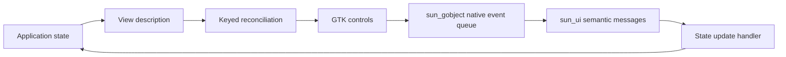

# sun_ui

An experimental React-like UI library written in Sun, with a platform-independent
core and a GTK rendering backend. Application state describes the interface;
events update state; reconciliation updates existing controls while preserving
their keyed identity.

GTK is currently the only graphical backend. The core can be built and tested
without it, but displaying an interface requires the backend. This prototype
supports native buttons in a flat vertical list, demonstrated by a counter and a
task list. It is not yet a general widget toolkit.

## Setup

Run commands from the repository root. The included VS Code devcontainer provides
Sun and the system dependencies. Alternatively, build and run the development
image directly:

```sh
docker build -t sun-ui-dev .
docker run --rm --user "$(id -u):$(id -g)" \
  -v "$PWD:/workspaces/sun_ui" sun-ui-dev ./build.sh
```

For a local Debian/Ubuntu setup, install the published Sun development package:

```sh
./scripts/bootstrap-sun.sh --update
```

Installation requires network access and package-install privileges; the package
supports amd64. Use the development compiler rather than an older system version.
Set `SUN_EXECUTABLE=/absolute/path/to/sun` to use a specific compiler.

### Build and test the core

```sh
./build.sh
```

This builds `build/sun_ui.moon` and runs the core tests without GTK or
`sun_gobject`. The compiler version and test results are recorded in `build/`.
For separate build, test, and formatting checks:

```sh
sun tools/build.sun -- build
sun tools/build.sun -- test
sun fmt --check src adapters tools examples tests
```

### Build the GTK backend

Install GTK 4 development packages and `pkg-config`, plus Xvfb, xauth, and
`dbus-run-session` for headless tests. The development image includes these tools.
Build [sun_gobject](https://github.com/namo-robotics/sun_gobject) with its own
`./build.sh`, using the same Sun compiler, then point sun_ui at that build:

```sh
SUN_GOBJECT_BUILD=../sun_gobject/build ./build.sh --gtk
```

This builds the core, backend, and examples, and runs both core tests and GTK
acceptance tests under a virtual display. The dependency build must contain
`sun_gobject.moon`, `sun_gtk.moon`, and `native/libsun_gobject_native.a`.

Inside the devcontainer, place the dependency checkout at `tmp/sun_gobject` and
use `SUN_GOBJECT_BUILD=tmp/sun_gobject/build`, or mount a sibling checkout.
Interactive examples require a graphical display.

## Examples

After building with `--gtk`:

| Run | Source | Demonstrates |
| --- | --- | --- |
| `./build/counter` | [counter.sun](examples/counter.sun) | Click to increment state and update the same button's label. |
| `./build/tasks` | [tasks.sun](examples/tasks.sun) | Add tasks, click to select, reverse their order, and remove the selected task. Stable keys preserve surviving controls and focus. |

Both examples accept `--self-test`; the GTK build runs these checks automatically.
The counter is the smallest complete example of a view function, event handler,
and application loop. The task list adds component composition and task IDs in
event payloads.

## Architecture



- **State and views:** `Session<State>` owns application state. View functions
  borrow it read-only and produce owned descriptions. Components are ordinary
  functions that append elements to a view; they never receive platform handles.
- **Reconciliation:** `Tree` compares sibling keys to create, update, reorder, or
  remove controls through a renderer. Reordering preserves control identity;
  duplicate keys are rejected before changing the interface.
- **Events:** The GTK backend translates `sun_gobject`'s FIFO native deliveries
  into semantic messages in bounded batches. `Session.dispatch` owns mutable state
  updates, handler failure policy, and rendering once per batch. Messages carry an
  action number and an integer payload.
- **GTK backend:** Owns windows, boxes, controls, and subscriptions through checked
  `sun_gobject` APIs. It chooses collection batches, keyed placement, focus requests,
  and when to stop after window closure. GTK provides layout, text rendering,
  keyboard activation, focus navigation, and native button accessibility.
- **Dependency boundary:** `sun_gobject` owns native reference lifetimes, parenting
  and thread checks, signal delivery, and GLib timeout sources. Its `gtk.EventQueue`
  owns no application state and applies no render or window-lifetime policy.
  `sun_ui` uses that queue directly rather than the optional imperative
  `gtk.EventLoop<State>`. The platform-independent core imports neither GTK nor
  `sun_gobject`.

| Path | Responsibility |
| --- | --- |
| [src/ui.sun](src/ui.sun) | Views, state sessions, event queues, and reconciliation |
| [adapters/gtk/renderer.sun](adapters/gtk/renderer.sun) | Checked GTK widgets and native-to-semantic event translation |
| [examples/](examples/) | Runnable applications and GTK acceptance scenarios |
| [tests/](tests/) | Core tests using a recording renderer |
| [tools/build.sun](tools/build.sun) | Build and test orchestration |

Applications import `sun_ui.moon`. GTK applications additionally import
`sun_ui_gtk.moon`, `sun_gobject.moon`, and `sun_gtk.moon`, and link GTK and the
`sun_gobject` native archive. See the examples for the manifests and application
loop. Call `Tree.shutdown(renderer)` when a session ends to clear mounted resources.
Renderer or handler errors stop the affected tree; recreate the session to recover.

The current implementation allocates view storage on each render and uses linear
key searches, making it suitable for small prototypes. Nested layouts, editable
controls, typed message payloads, and additional backends remain future work.
