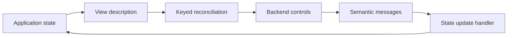

# sun_ui

[](https://github.com/namo-robotics/sun_ui/actions/workflows/ci.yml)

## Overview

An experimental React-like UI library written in Sun. Application state describes
the interface; events update state; reconciliation updates existing controls while
preserving their keyed identity. The core is platform-independent, with GTK as the
current graphical backend.

The library supports nested layouts, grids, scrolling, labels, buttons, controlled
form inputs, and structured themes. Optional [XML views](docs/xml-views.md) compile
to ordinary Sun functions.

This repository also maintains [sun_plot](src/plot/README.md), a separate scientific
plotting library built on sun_ui, with line and scatter series, labelled axes,
legends, subplot grids, SVG export, and a resizable GTK viewer.

## Install

Download prebuilt bundles from the rolling
[dev release](https://github.com/namo-robotics/sun_ui/releases/tag/dev), updated after
CI passes on `main`:

After a successful GTK build and test run, create the package locally with
`./scripts/package-linux.sh`. Packaging uses existing build outputs.

### Build and test the core

```sh
./build.sh
```

This builds `build/sun_ui.moon`, `build/sun_plot.moon`, and the plot export example,
then runs UI, plotting, and XML compiler tests and generates the XML examples
without GTK or `sun_gobject`. The compiler version and test results are recorded in `build/`.
For separate build, test, and formatting checks:

```sh
sun src/tools/build.sun -- build
sun src/tools/build.sun -- test
sun fmt --check src/ui.sun src/styles.sun src/markup src/drawing.sun src/plot src/graphics src/adapters src/tools examples tests
```

The Debian package depends on the published Sun compiler and `sun-gobject`
packages. It installs bundles under `/usr/lib/sun` and the XML compiler at
`/usr/bin/sun-viewc`. For downloaded bundles, add their directory with `--lib-path`.
GTK applications also require the native dependencies described under [Backends](#backends).

Use the compiler version recorded in the release's `sun-version.txt` and matching
native dependencies. Rebuild all bundles together after a compiler update. Linux
bundles cannot be reused on macOS; Intel macOS releases are not provided.

## Build from source

Run commands from the repository root. The included VS Code devcontainer provides
Sun and the system dependencies. You can also run the development image directly:

```sh
docker build -t sun-ui-dev .
docker run --rm --user "$(id -u):$(id -g)" \
  -v "$PWD:/workspaces/sun_ui" sun-ui-dev ./build.sh
```

For a local Debian/Ubuntu amd64 setup, install the development compiler with
`./scripts/bootstrap-sun.sh --update`. This requires network access and
package-install privileges. Set `SUN_EXECUTABLE=/absolute/path/to/sun` to select a
specific compiler.

Build and test the core without GTK or `sun_gobject`:

```sh
./build.sh
```

This builds `build/sun_ui.moon`, `build/sun_plot.moon`, and the plot export example,
runs UI, plotting, and XML compiler tests, and generates the XML examples. Outputs,
compiler records, and test results go into `build/`.

For the GTK build, install GTK 4 development packages, `pkg-config`, Xvfb, xauth,
and `dbus-run-session`. The development image includes these and `vcs2l` (the `vcs`
command). To install `vcs2l` locally with `python3-venv` available:

```sh
python3 -m venv tmp/vcs2l
tmp/vcs2l/bin/pip install vcs2l==1.1.7
export PATH="$PWD/tmp/vcs2l/bin:$PATH"
```

Import dependencies and build them with the same Sun compiler:

```sh
vcs import --skip-existing --input deps.repos .
bash src/sun_gobject/build.sh
./build.sh --gtk
```

The GTK build also runs acceptance tests under a virtual display. The default
dependency build is `src/sun_gobject/build`; set `SUN_GOBJECT_BUILD` to use another
location. Dependencies are independent checkouts with their own development
instructions. The import preserves existing checkouts; builds never fetch or reset
them. Toolkit CI imports only `sun_gobject` from [deps.repos](deps.repos).

On Apple Silicon macOS, use `./scripts/build-macos.sh` with the Homebrew dependencies
listed in [.github/workflows/ci.yml](.github/workflows/ci.yml). To package an existing
successful Linux GTK build, run `./scripts/package-linux.sh`.

For separate build, test, and formatting checks:

```sh
sun src/tools/build.sun -- build
sun src/tools/build.sun -- test
sun fmt --check src/ui.sun src/styles.sun src/markup src/drawing.sun src/plot src/adapters src/tools examples tests
```

[sun-config.json](sun-config.json) declares build targets;
[src/tools/build.sun](src/tools/build.sun) handles build order, XML generation, and
native linker flags. Use the build script instead of invoking every configuration
target directly. Keep formatting scoped to first-party paths to avoid changing
independent checkouts.

## Examples

After building with `./build.sh --gtk`, run these examples in a graphical session:

| Run | Source | Demonstrates |
| --- | --- | --- |
| `./build/counter` | [counter/main.sun](examples/counter/main.sun) | State updates and button labels |
| `./build/tasks` | [tasks/main.sun](examples/tasks/main.sun) | Component composition, selection, and keyed reordering |

Both accept `--self-test`; the GTK build runs these checks automatically.

To export and display the four-panel scientific plotting example:

```sh
./build.sh
./build/plot-export                 # build/scientific-plot.svg
./build.sh --plot-gtk               # native viewer and acceptance test
./build/plot-viewer
```

The viewer needs the GTK dependency build and librsvg (`librsvg2-2` on Debian/Ubuntu).
Use **Export SVG…** to save the current figure. See the
[sun_plot documentation](src/plot/README.md) for its API and limitations.

Two independent applications also use sun_ui:
[sun_video_editor](https://github.com/namo-robotics/sun_video_editor) and
[sun_accent_popup](https://github.com/namo-robotics/sun_accent_popup). Their repositories
provide application setup, build, and packaging instructions; toolkit builds do not
require them.

## High-level architecture



- **State and views:** `Session<State>` owns application state. View functions
  borrow it read-only and produce owned descriptions. Components are ordinary Sun
  functions without platform handles.
- **Reconciliation:** `Tree` compares parent-scoped keys and node kinds to create,
  update, reorder, or remove controls. Stable keys preserve control identity;
  duplicate keys are rejected before changing the interface.
- **Events:** Backends translate native events into semantic messages.
  `Session.dispatch` updates state and renders once per batch.
- **Library boundaries:** The core imports neither GTK nor `sun_gobject`.
  `sun_plot` builds on sun_ui's public APIs; sun_ui does not depend on sun_plot.

The main implementation lives in [src/ui.sun](src/ui.sun), with vector drawings and
SVG export in [src/drawing.sun](src/drawing.sun), plotting in [src/plot/](src/plot/),
and platform adapters in [src/adapters/](src/adapters/). Core [tests](tests/) use a
recording renderer.

Call `Tree.shutdown(renderer)` when a session ends to clear mounted resources.
Renderer or handler errors stop the affected tree; recreate the session to recover.
The current implementation allocates view storage on each render and uses linear
key searches, making it suitable for small applications. See the
[XML view guide](docs/xml-views.md) for generation, forms, resource dictionaries,
themes, component scopes, templates, and renderer migration. XML tooling requires
the current published compiler with XML source spans; the build checks this API.
The [upstream notes](upstream/README.md) record the migration history.
GTK applications require the corresponding changes in the separate sun_gobject
checkout; additional rendering backends remain future work.

## Optional OpenGL graphics

`./build.sh --graphics` builds the owned-frame graphics API, embedded GTK viewport,
separate SDL3 window, and their acceptance tests. Run `./build/graphics` for a
shared 3D scene with GTK settings and an SDL FPS camera. See
[graphics integration](docs/graphics.md) for dependencies, ownership, the combined
event loop, and Wayland's Cairo decoration-plugin requirement. This requires the
matching GLArea bindings in the separate sun_gobject checkout. macOS graphics
compatibility is validated in CI.

## Apple Silicon macOS releases

The macOS job in the CI workflow builds and tests native bundles with the Homebrew Sun compiler
and GTK, then publishes `sun_ui-arm64-apple-darwin.tar.gz` to the
[dev release](https://github.com/namo-robotics/sun_ui/releases/tag/dev)
alongside the Linux bundles after all CI jobs pass on main.
Run `./scripts/build-macos.sh` on an Apple Silicon Mac
with the dependencies listed in `.github/workflows/ci.yml`.

Archives include the compiler version used to build the bundles. Consumers must
use a compatible compiler and matching native dependencies; Linux bundles cannot
be reused on macOS. Intel macOS is not covered by these releases.
