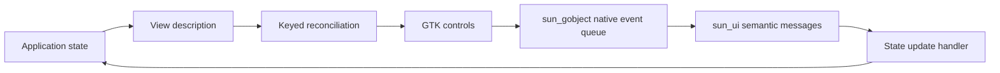

# sun_ui

[](https://github.com/namo-robotics/sun_ui/actions/workflows/ci.yml)

An experimental React-like UI library written in Sun, with a platform-independent
core and a GTK rendering backend. Application state describes the interface;
events update state; reconciliation updates existing controls while preserving
their keyed identity.

GTK is currently the only graphical backend. The core can be built and tested
without it, but displaying an interface requires the backend. This prototype
supports native buttons in a flat vertical list, demonstrated by a counter and a
task list. It is not yet a general widget toolkit.

This repository also maintains **[sun_plot](src/plot/README.md)**, a separate
scientific plotting library built on sun_ui. It supports line and scatter series,
labelled linear axes, legends, subplot grids, SVG export, and a resizable GTK
vector viewer. The plotting example presents a four-panel damped oscillator study.

## Setup

Run commands from the repository root. The included VS Code devcontainer provides
Sun and the system dependencies. Alternatively, build and run the development
image directly:

```sh
docker build -t sun-ui-dev .
docker run --rm --user "$(id -u):$(id -g)" \
  -v "$PWD:/workspaces/sun_ui" sun-ui-dev ./build.sh
```

For a local Debian/Ubuntu setup, install the published Sun development package:

```sh
./scripts/bootstrap-sun.sh --update
```

Installation requires network access and package-install privileges; the package
supports amd64. Use the development compiler rather than an older system version.
Set `SUN_EXECUTABLE=/absolute/path/to/sun` to use a specific compiler.

### Development releases

After both CI jobs pass on a push to `main`, CI updates the rolling
[dev prerelease](https://github.com/namo-robotics/sun_ui/releases/tag/dev) with
the core, plotting, and optional GTK `.moon` bundles for x86_64 Linux. This
includes each merge to `main`; pull requests and other branches do not publish.
The release includes `sun-version.txt` identifying the compiler used. Add the
download directory with `--lib-path`; GTK bundles still need the dependency
build and system libraries described below.

### Build and test the core

```sh
./build.sh
```

This builds `build/sun_ui.moon`, `build/sun_plot.moon`, and the plot export example,
then runs the UI and plotting tests without GTK or
`sun_gobject`. The compiler version and test results are recorded in `build/`.
For separate build, test, and formatting checks:

```sh
sun tools/build.sun -- build
sun tools/build.sun -- test
sun fmt --check src/ui.sun src/drawing.sun src/plot src/adapters tools examples tests
```

### Build the GTK backend

Install GTK 4 development packages and `pkg-config`, plus Xvfb, xauth, and
`dbus-run-session` for headless tests. The development image includes these tools.
Manage the [sun_gobject](https://github.com/namo-robotics/sun_gobject) checkout with
[vcs2l](https://github.com/ros-infrastructure/vcs2l/), whose command is `vcs`.
The development image includes it. For an existing local environment, install
`python3-venv`, then set up the same tool version:

```sh
python3 -m venv tmp/vcs2l
tmp/vcs2l/bin/pip install vcs2l==1.1.7
export PATH="$PWD/tmp/vcs2l/bin:$PATH"
```

Import the development checkout and build both projects with the same Sun compiler:

```sh
vcs import --skip-existing --input deps.repos .
bash src/sun_gobject/build.sh
./build.sh --gtk
```

This builds the core, backend, and examples, and runs both core tests and GTK
acceptance tests under a virtual display. The dependency build must contain
`sun_gobject.moon`, `sun_gtk.moon`, and `native/libsun_gobject_native.a`.

The default dependency build is `src/sun_gobject/build`; `SUN_GOBJECT_BUILD`
can select another build. Interactive examples require a graphical display.

### Working across repositories

`src/sun_gobject/` is a separate Git clone, ignored by sun_ui, with its own history
and development instructions. Edit and review binding changes there; review UI
changes in this repository. The import command preserves existing checkouts.
Builds never fetch or reset the dependency automatically.

Development and CI both use `deps.repos`, which follows `main`. Local dependency
edits are not captured by the parent repository or by the manifest.

```sh
vcs status src/sun_gobject
git -C src/sun_gobject diff
```

Keep formatting scoped to the first-party paths shown above, so sun_ui commands
do not reformat the nested dependency.

## Examples

To export and display a scientific plot:

```sh
./build.sh
./build/plot-export                 # build/scientific-plot.svg
./build.sh --plot-gtk               # native plot viewer and acceptance test
./build/plot-viewer
```

Use **Export SVG…** in the plot window to save the current figure to a chosen file.

The plot viewer requires the sun_gobject build described above, GTK 4, and librsvg
(`librsvg2-2` on Debian/Ubuntu). See [sun_plot](src/plot/README.md) for the plotting API and
current limitations.

After building with `--gtk`:

| Run | Source | Demonstrates |
| --- | --- | --- |
| `./build/counter` | [counter.sun](examples/counter.sun) | Click to increment state and update the same button's label. |
| `./build/tasks` | [tasks.sun](examples/tasks.sun) | Add tasks, click to select, reverse their order, and remove the selected task. Stable keys preserve surviving controls and focus. |

Both examples accept `--self-test`; the GTK build runs these checks automatically.
The counter is the smallest complete example of a view function, event handler,
and application loop. The task list adds component composition and task IDs in
event payloads.

## Architecture



- **State and views:** `Session<State>` owns application state. View functions
  borrow it read-only and produce owned descriptions. Components are ordinary
  functions that append elements to a view; they never receive platform handles.
- **Reconciliation:** `Tree` compares sibling keys to create, update, reorder, or
  remove controls through a renderer. Reordering preserves control identity;
  duplicate keys are rejected before changing the interface.
- **Events:** The GTK backend translates `sun_gobject`'s FIFO native deliveries
  into semantic messages in bounded batches. `Session.dispatch` owns mutable state
  updates, handler failure policy, and rendering once per batch. Messages carry an
  action number and an integer payload.
- **GTK backend:** Owns windows, boxes, controls, and subscriptions through checked
  `sun_gobject` APIs. It chooses collection batches, keyed placement, focus requests,
  and when to stop after window closure. GTK provides layout, text rendering,
  keyboard activation, focus navigation, and native button accessibility.
- **Dependency boundary:** `sun_gobject` owns native reference lifetimes, parenting
  and thread checks, signal delivery, and GLib timeout sources. Its `gtk.EventQueue`
  owns no application state and applies no render or window-lifetime policy.
  `sun_ui` uses that queue directly rather than the optional imperative
  `gtk.EventLoop<State>`. The platform-independent core imports neither GTK nor
  `sun_gobject`.

| Path | Responsibility |
| --- | --- |
| [src/ui.sun](src/ui.sun) | Views, state sessions, event queues, and reconciliation |
| [src/drawing.sun](src/drawing.sun) | Platform-independent vector drawings and SVG export |
| [src/plot/](src/plot/) | Scientific plotting library, API documentation, and roadmap |
| [src/adapters/gtk/drawing.sun](src/adapters/gtk/drawing.sun) | Resizable native vector drawing window |
| [src/adapters/gtk/renderer.sun](src/adapters/gtk/renderer.sun) | Checked GTK widgets and native-to-semantic event translation |
| [examples/](examples/) | Runnable applications and GTK acceptance scenarios |
| [tests/](tests/) | Core tests using a recording renderer |
| [tools/build.sun](tools/build.sun) | Build and test orchestration |

Applications import `sun_ui.moon`. GTK applications additionally import
`sun_ui_gtk.moon`, `sun_gobject.moon`, and `sun_gtk.moon`, and link GTK and the
`sun_gobject` native archive. See the examples for the manifests and application
loop. Call `Tree.shutdown(renderer)` when a session ends to clear mounted resources.
Renderer or handler errors stop the affected tree; recreate the session to recover.

The current implementation allocates view storage on each render and uses linear
key searches, making it suitable for small prototypes. Nested layouts, editable
controls, typed message payloads, and additional backends remain future work.
